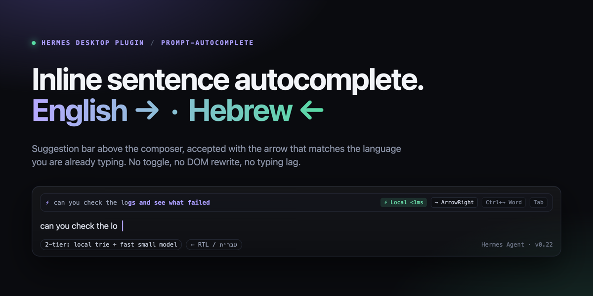
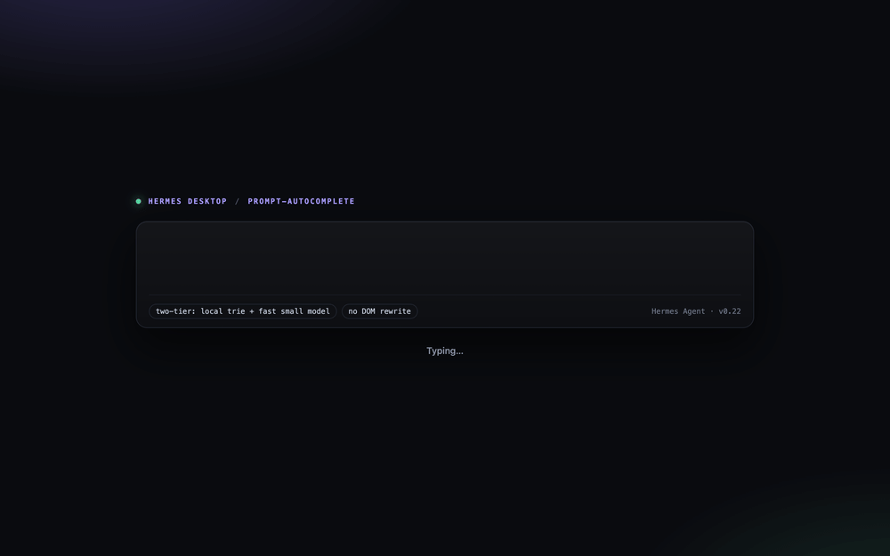

# Prompt Autocomplete (`prompt-autocomplete`)



Inline sentence completion for the **Hermes Desktop** composer. The bar above the input finishes the sentence
you are already typing and names the direction it detected — `LTR · → full · Ctrl+→ word · Tab`, or
`RTL · ← full · Ctrl+← word · Tab` — so the keys follow the language instead of a setting. No toggle,
no settings, and no keystrokes rewriting the editor.



<sub>Rendered from `docs/demo.html` — the same bar markup and key legend the plugin paints in `COMPOSER_AREAS.top`.</sub>

- **Zero typing lag** — the `contentEditable` is never mutated on keystrokes. Suggestions render in
  `COMPOSER_AREAS.top` and an accepted completion is committed with `host.composer.setDraft()`.
- **Implied direction** — the last strong directional character before the caret decides
  (`[\u0590-\u08FF]` → RTL, `[A-Za-z]` → LTR). Nothing to configure per language.
- **Works without the backend or the worker** — the builtin phrase trie runs on the main thread, so the bar
  still appears in packaged builds that refuse `blob:` workers and before any Python backend is enabled.

## Install

```bash
hermes plugins install prompt-autocomplete
hermes plugins enable prompt-autocomplete
```

Restart the desktop app if the bar does not appear; the plugin inventory is in **Settings → Plugins**.

## Why it's different

- **Sub-1 ms, off the main thread.** Phrase matching runs in a `WebWorker` trie, with a main-thread
  fallback so the bar still appears when `blob:` workers are blocked. No network round-trip to show a
  suggestion, and no keystroke ever waits on it.
- **Trained on your own prompts.** On load the trie is seeded with up to 400 of your own recent prompt
  phrases from the active profile's `state.db`, on device. Completions sound like the way you already
  write, and that corpus never leaves the machine.
- **Direction is implied, not configured.** The legend names what it detected — `LTR` or `RTL` — and lists
  the keys for that direction, so a Hebrew line never asks you to flip a toggle.

## Keys

| Direction | Accept full continuation | Accept one word | Accept full |
| --- | --- | --- | --- |
| LTR (English) | `→` `ArrowRight` | `Ctrl + →` | `Tab` |
| RTL (Hebrew / Arabic) | `←` `ArrowLeft` | `Ctrl + ←` | `Tab` |
| Either | `Escape` dismisses the current suggestion | | |

## How it works

| Tier | Where | Latency | Source |
| --- | --- | --- | --- |
| 1a | Main thread | `< 1 ms` | Builtin English + Hebrew developer phrases, always on |
| 1b | WebWorker | `< 1 ms` | Prefix / N-gram trie seeded from up to 400 recent prompts in `state.db` (`GET /corpus`) |
| 2 | Plugin backend | `~200–600 ms` | Small-model continuation race via `agent.plugin_llm.PluginLlm` (`POST /complete`, `max_tokens=10`) |

Tier 1a/1b answer first and render the bar immediately. Tier 2 is only asked when the local tiers stay
silent after a `90 ms` typing pause, so ordinary typing never touches the network.

Optional — let Tier 2 race four fast models instead of using the registered auxiliary task slot:

```yaml
plugins:
  entries:
    prompt-autocomplete:
      llm:
        allow_model_override: true
        allowed_models: ["*"]
```

Without that block every Tier 2 request goes through the plugin's own `prompt_autocomplete` auxiliary task
slot, which you can point at any provider/model in Hermes.

## Requirements

- Hermes Agent `>= 0.21.0` with the desktop app.
- No tools, hooks, middleware, or environment variables; nothing is contributed outside the plugin SDK
  surface (`COMPOSER_AREAS.top`, `STATUSBAR_AREAS.right`, `host.composer.setDraft`, `ctx.rest`, `ctx.storage`).

## Disclosure (Catalog Rule 13)

- **Local reads** — when the backend is enabled, `GET /corpus` reads up to 400 recent user prompt phrases from
  the active profile's `state.db` through the public `hermes_state.SessionDB` API (`search_sessions`,
  `get_messages`) to seed the in-memory trie. Message text is used only for matching; it is never sent
  anywhere, and `.env` / credentials are never read.
- **Network / LLM** — only after the local tiers find no match and typing pauses: the last 180 characters of
  the current draft line go to the user's own configured LLM provider through Hermes's host-owned
  `agent.plugin_llm.PluginLlm` facade, with `max_tokens=10`, `temperature=0.1`, a `2.2 s` timeout and a
  bounded in-process result cache. No third-party endpoint is contacted directly.
- **Local writes** — one preference, `enabled`, in plugin-scoped `ctx.storage`.
- **Telemetry** — none. No self-updater, no analytics, no background polling.

## Development

```bash
hermes plugins validate . --install-deps   # manifest, capability probe, desktop surface, security scan
python3 -m http.server 8791               # serve docs/banner.png preview if you edit it
```

`desktop/plugin.js` is plain ESM with no build step: only `@hermes/plugin-sdk`, `react`, and
`react/jsx-runtime` are importable, and JSX syntax is not compiled — UI is written with `jsx()` calls.

## License

MIT — Copyright (c) 2026 Shachar Iphraimov (`iphraimov@gmail.com`)
